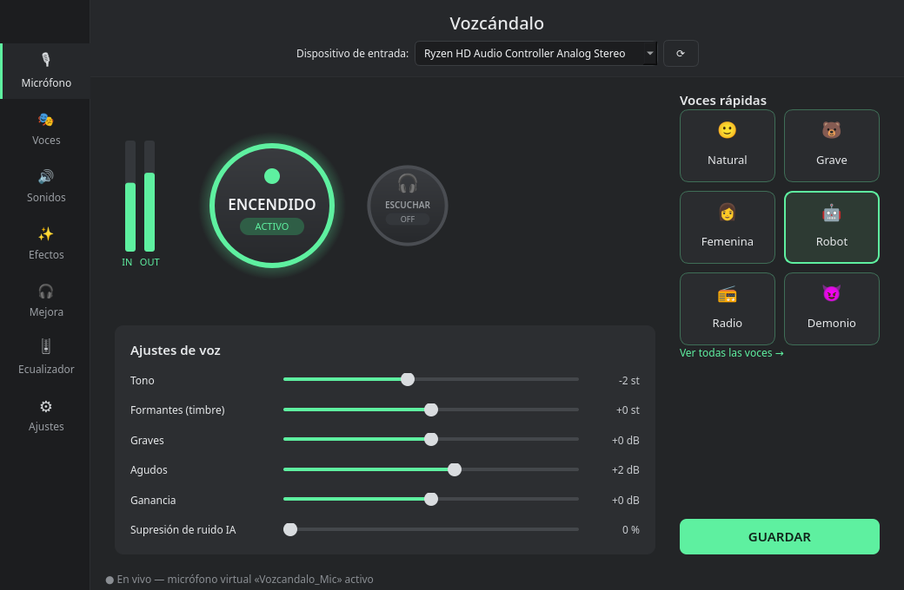
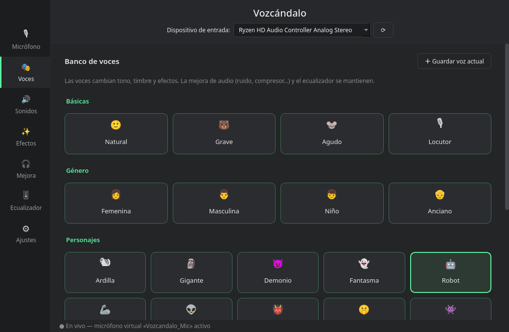
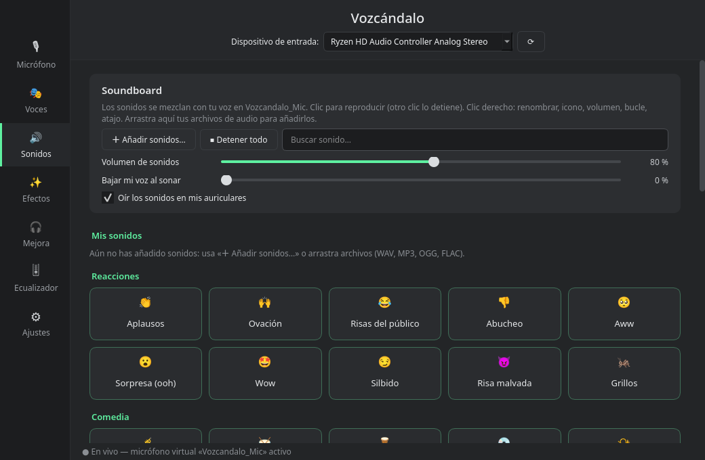

# 🎭 Vozcándalo

**Haz un escándalo con tu voz.**

Vozcándalo cambia tu voz **mientras hablas**: puedes sonar como un robot, un demonio, una ardilla, un locutor de radio o un fantasma. También lanza sonidos de reacción (aplausos, trombón triste, ba-dum-tss…) en mitad de la partida o del directo. Tus amigos te oyen en **Discord, OBS, juegos o cualquier app** que use el micrófono, sin instalar nada raro.



> Versión 0.1.0 · Linux (PipeWire) · Gratis y de código abierto

---

## ✨ Qué puedes hacer

- 🎭 **26 voces listas para usar.** Grave, aguda, femenina, masculina, niño, anciano, robot, alien, demonio, monstruo, susurro, voz de 8 bits, radio, teléfono, megáfono, bajo el agua, cueva, catedral…
- 🎚️ **Crear tu propia voz.** Mueve el tono y el timbre por separado (pasas de voz de hombre a voz de mujer sin sonar a ardilla), añade eco, reverberación, distorsión… y guárdala con tu nombre.
- 🔊 **Soundboard con 52 sonidos reales.** Aplausos, abucheos, risas, grillos, trombón triste, bocina, gong, explosión, gato, perro… Puedes añadir tus propios audios arrastrándolos a la ventana.
- 🎧 **Micrófono más limpio.** Quita el ruido de fondo con IA (el ventilador, el teclado, la calle), suaviza las «eses» que pitan y equilibra el volumen para que no se te oiga ni muy bajo ni a gritos.
- 👂 **Escúchate.** Con el botón de los auriculares oyes cómo suenas antes de soltarlo en el chat.



## 🚀 Cómo empezar

1. Abre una terminal en la carpeta del proyecto y prepara la app (solo la primera vez):
   ```bash
   python3 -m venv .venv
   .venv/bin/pip install -r requirements.txt
   ```
2. Ábrela:
   ```bash
   ./run.sh
   ```
3. Elige tu micrófono arriba y pulsa el **botón grande** para encenderlo.
4. En Discord (o la app que uses), ve a *Ajustes de voz* y elige **Vozcandalo_Mic** como micrófono.
5. ¡Listo! Elige una voz y a hacer el escándalo. 🎉

## ❓ Preguntas rápidas

**No me oyen en Discord.**
Comprueba que el botón grande pone *ENCENDIDO* y que en Discord el micrófono es *Vozcandalo_Mic*.

**Se me oye con un poco de retraso.**
En *Ajustes → Motor de tono*, cambia a *Baja latencia*. Ganas rapidez a cambio de un poco de naturalidad en los cambios de tono.

**Hay mucho ruido de fondo.**
Ve a *Mejora* y elige el perfil *Llamada limpia* o *Streaming*.

**¿Puedo usar mis propios sonidos?**
Sí: en *Sonidos*, pulsa «Añadir sonidos…» o arrastra archivos WAV, MP3, OGG o FLAC.



## 🛠️ Para curiosos

- Hecho en Python con PySide6 (Qt). El audio va por PipeWire/PulseAudio (`parec`/`pacat`) y no necesita drivers.
- El tono y los formantes se cambian con un vocoder de fase con envolvente cepstral. Hay un modo de baja latencia con línea de retardo.
- La supresión de ruido usa [RNNoise](https://github.com/xiph/rnnoise), y los efectos, [pedalboard](https://github.com/spotify/pedalboard) de Spotify.

| Carpeta | Qué hay |
|---|---|
| `vozcandalo/dsp.py` | Cadena de procesado, vocoder, RNNoise, banco de voces y perfiles de mejora |
| `vozcandalo/engine.py` | Hilo de audio: micrófono → efectos → micrófono virtual |
| `vozcandalo/virtualmic.py` | Crea y elimina el micrófono virtual |
| `vozcandalo/soundboard.py` | Biblioteca de sonidos y mezclador |
| `vozcandalo/ui.py` | Interfaz |
| `sounds/` | Sonidos incluidos (`sounds.json` es el catálogo) |
| `tools/fetch_sounds.py` | Vuelve a descargar los sonidos de Freesound |

Tus ajustes se guardan en `~/.config/vozcandalo/` y tus sonidos en `~/.local/share/vozcandalo/`.

## 🙌 Créditos

Todos los sonidos incluidos son de dominio público (CC0): grabaciones de [Freesound](https://freesound.org) y voces de [Kenney](https://kenney.nl). La lista completa está en [`sounds/CREDITS.md`](sounds/CREDITS.md).
