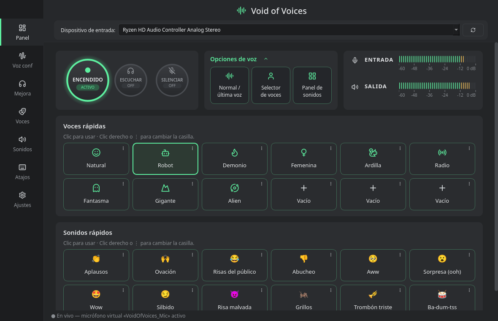
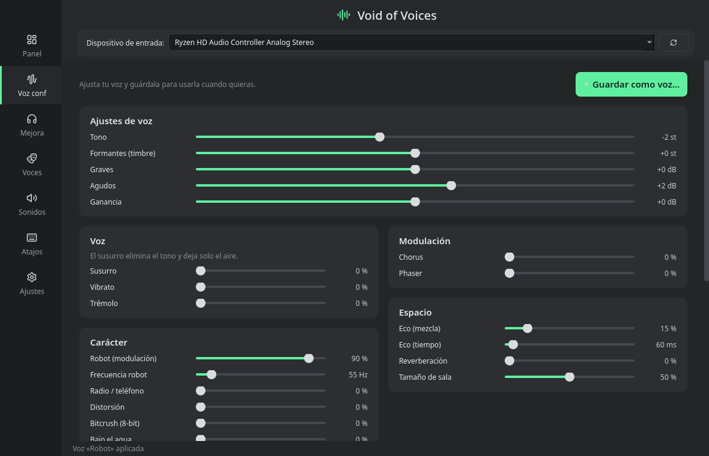
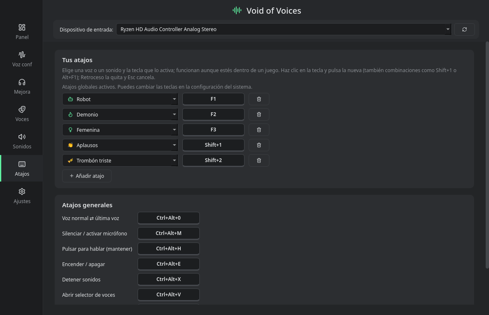
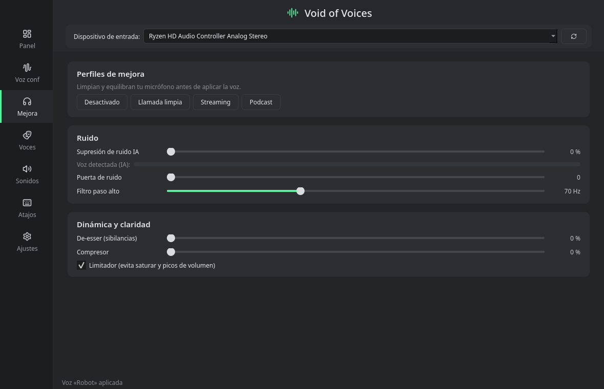
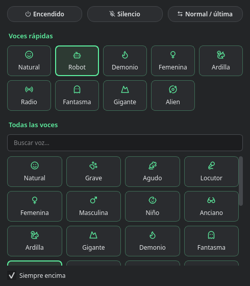
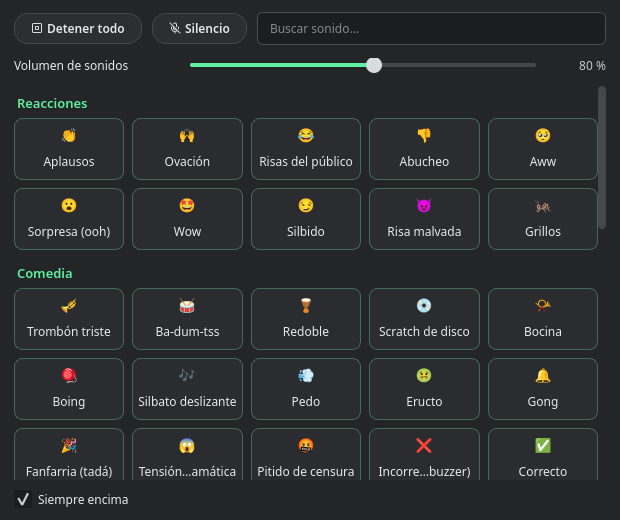

# 🌌 Void of Voices

**Tu voz entra en el vacío… y sale convertida en otra.**

Void of Voices cambia tu voz **mientras hablas**: puedes sonar como un robot, un demonio, una ardilla, un locutor de radio o un fantasma. Además lanza sonidos de reacción (aplausos, trombón triste, ba-dum-tss…) en mitad de la partida o del directo. Tus amigos te oyen en **Discord, OBS, juegos o cualquier app** que use el micrófono.



> 🐧 Linux · 🪟 Windows · Gratis y de código abierto · 🇪🇸 Español / 🇬🇧 English

---

## ⬇️ Descargar

Entra en **[Releases](https://github.com/daetrox/void-of-voices/releases/latest)** y baja la versión para tu sistema:

| Sistema | Archivo | Cómo se abre |
|---|---|---|
| 🐧 Linux | `VoidOfVoices-…-x86_64.AppImage` | Clic derecho → *Propiedades* → marca *Ejecutable*, y doble clic. |
| 🪟 Windows | `VoidOfVoices-…-Windows-Setup.exe` | Instálalo como cualquier programa. |
| 🪟 Windows sin instalar | `VoidOfVoices-…-Windows-portable.zip` | Descomprime y abre `VoidOfVoices.exe`. |

> **En Windows** hace falta un micrófono virtual para que las demás apps oigan tu voz cambiada: el driver gratuito [VB-Cable](https://vb-audio.com/Cable/). Si no lo tienes, Void of Voices lo descarga de su web oficial, comprueba que es el archivo auténtico y abre su instalador: solo pulsas *Install Driver*. En Linux no hace falta nada más.

## ✨ Qué puedes hacer

- 🎭 **26 voces listas para usar:** grave, aguda, femenina, masculina, niño, anciano, robot, alien, demonio, monstruo, susurro, 8 bits, radio, teléfono, megáfono, bajo el agua, cueva, catedral…
- 🎚️ **Tu propia voz:** en *Voz conf* mueves el tono y el timbre por separado (de voz de hombre a voz de mujer sin sonar a ardilla), le añades eco, reverberación, distorsión… y la guardas con tu nombre y tu icono.
- 🔊 **Soundboard con 52 sonidos reales:** aplausos, abucheos, risas, grillos, trombón triste, bocina, gong, explosión, gato, perro… Añade los tuyos arrastrándolos a la ventana; su icono puede ser un emoji, un icono o una imagen tuya.
- ⚡ **Todo a mano en el Panel:** enciende, escúchate o silénciate de un clic. Tus voces y sonidos favoritos están en casillas rápidas que cambias con clic derecho, y los medidores te enseñan cuánto entra y sale.
- ⌨️ **Atajos que funcionan dentro del juego:** cualquier voz o sonido en la tecla que quieras (`F1`, `Shift+1`, `Alt+F1`…), además de silenciar, pulsar para hablar o volver a tu voz normal.
- 🪟 **Ventanas pequeñas:** un selector de voces y un panel de sonidos que puedes dejar siempre encima del juego.
- 🎧 **Micrófono más limpio:** quita el ruido de fondo con IA (el ventilador, el teclado, la calle), suaviza las «eses» que pitan y equilibra el volumen.
- 📦 **Comparte con tus amigos:** exporta tus voces (`.vovoice`) o un paquete con tus sonidos (`.vopack`), y ellos solo tienen que arrastrarlos a su Void of Voices.

## 📸 Así se ve

| | |
|---|---|
|  **Voz conf:** crea tu voz y guárdala. |  **Voces:** el banco completo, más las tuyas en *Personalizadas*. |
|  **Sonidos:** el soundboard, con buscador, volumen y paquetes. |  **Atajos:** una fila por voz o sonido, con la tecla que quieras. |
|  **Mejora:** limpia tu micrófono con un perfil. |  <br>**Ventanas rápidas:** selector de voces y panel de sonidos. |

## 🚀 Cómo empezar

1. Abre Void of Voices, elige tu micrófono arriba y pulsa el **botón grande** del *Panel* para encenderlo.
2. En Discord (o la app que uses), ve a *Ajustes de voz* y elige como micrófono:
   - en **Linux**: **VoidOfVoices_Mic**;
   - en **Windows**: **CABLE Output (VB-Audio)**.
3. Elige una voz en el *Panel*… ¡y a hacer ruido! 🎉

Los ajustes se guardan solos: la próxima vez todo estará como lo dejaste.

### ⌨️ Atajos de teclado

En la sección **Atajos**, pulsa *＋ Añadir atajo*, elige una voz o un sonido y pulsa la tecla que quieras. Las teclas repetidas se marcan en rojo. Además vienen estos atajos generales:

| Atajo | Qué hace |
|---|---|
| `Ctrl+Alt+0` | Voz normal ⇄ última voz usada |
| `Ctrl+Alt+M` | Silenciar / activar el micrófono |
| `Ctrl+Alt+H` | Pulsar para hablar (actívalo en *Ajustes → Micrófono*) |
| `Ctrl+Alt+E` | Encender / apagar |
| `Ctrl+Alt+X` | Parar todos los sonidos |
| `Ctrl+Alt+V` / `Ctrl+Alt+B` | Abrir el selector de voces / el panel de sonidos |

- **Linux (KDE, GNOME…):** la primera vez el sistema te pide permiso para los atajos.
- **Hyprland:** la app pone sus teclas sola, sin pisar las tuyas, y las quita al salir.
- **Windows:** funcionan directamente.

## ❓ Preguntas rápidas

**No me oyen en Discord.**
Comprueba que el botón grande pone *ENCENDIDO* y que en Discord el micrófono es *VoidOfVoices_Mic* (Linux) o *CABLE Output* (Windows). En Windows, desactiva también la supresión de ruido de Discord: puede «borrar» parte del efecto.

**Windows dice que la app es peligrosa o «no reconocida».**
Es un falso positivo habitual en programas pequeños sin firma digital de pago. El código es abierto, y GitHub compila cada versión de forma automática y pública. Si te aparece *«Windows protegió tu PC»*, pulsa *Más información → Ejecutar de todas formas*.

**Se me oye con un poco de retraso.**
En *Ajustes → Motor de tono*, elige *Baja latencia*. Ganas rapidez a cambio de un poco de naturalidad en los cambios de tono.

**Hay mucho ruido de fondo.**
Ve a *Mejora* y elige el perfil *Llamada limpia* o *Streaming*.

**¿Puedo cerrar la ventana?**
Sí: Void of Voices sigue funcionando en la bandeja del sistema (junto al reloj). Para cerrarlo del todo, usa *Salir* en su menú. En *Ajustes* también puedes hacer que arranque solo al encender el ordenador.

## 🛠️ Para curiosos

<details>
<summary>Ejecutar desde el código fuente</summary>

```bash
git clone https://github.com/daetrox/void-of-voices.git
cd void-of-voices
./run.sh          # la primera vez prepara el entorno (Python 3.10+)
```

En Linux necesita PipeWire (o PulseAudio) con `pactl`, `parec` y `pacat`, que vienen de serie en casi todas las distros.
</details>

- Hecho en Python con PySide6 (Qt).
- El audio va por PipeWire/PulseAudio en Linux y por WASAPI en Windows.
- El tono y los formantes se cambian con un vocoder de fase con envolvente cepstral.
- La supresión de ruido usa [RNNoise](https://github.com/xiph/rnnoise) y los efectos, [pedalboard](https://github.com/spotify/pedalboard).
- Los emojis son [Twemoji](https://github.com/mozilla/twemoji-colr) y los iconos, [Lucide](https://lucide.dev): se ven igual en cualquier sistema.
- Las versiones para descargar se compilan solas con GitHub Actions (`.github/workflows/build.yml`), que prueba cada una en Linux y Windows antes de publicarla.

| Carpeta | Qué hay |
|---|---|
| `voidofvoices/dsp.py` | Cadena de procesado, vocoder, RNNoise, banco de voces |
| `voidofvoices/engine.py` | Hilo de audio (backends PipeWire y WASAPI) |
| `voidofvoices/hotkeys.py` | Atajos globales (portal XDG, Hyprland y RegisterHotKey) |
| `voidofvoices/ui.py`, `windows.py`, `widgets.py` | Interfaz |
| `voidofvoices/packs.py` | Exportar e importar voces y paquetes de sonidos |
| `voidofvoices/i18n*.py` | Traducciones |
| `sounds/` | Sonidos incluidos; `tools/fetch_sounds.py` los vuelve a descargar |
| `packaging/` | PyInstaller, AppImage e instalador de Windows |

Los cambios de cada versión están en el [CHANGELOG](CHANGELOG.md).

## 🙌 Créditos

**Colaboradores:** [@matsukiender-star](https://github.com/matsukiender-star) (Matsuki Ender).

Todos los sonidos incluidos son de dominio público (CC0): grabaciones de [Freesound](https://freesound.org) y voces de [Kenney](https://kenney.nl). La lista completa está en [`sounds/CREDITS.md`](sounds/CREDITS.md).
